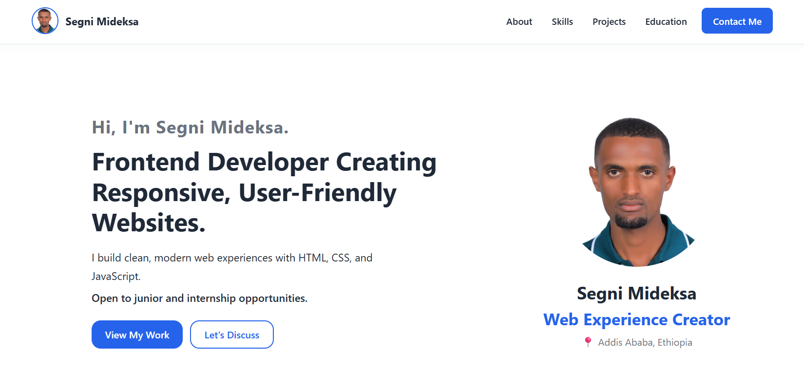

# Segni Mideksa | Frontend Developer Portfolio

A personal portfolio website showcasing my frontend development skills, projects, and learning journey. Built from scratch using HTML, CSS, and vanilla JavaScript.

**Live site:** [https://segni-mideksa.vercel.app/](https://segni-mideksa.vercel.app/)



## About the Project

This portfolio introduces me as a frontend developer based in Addis Ababa, Ethiopia. It showcases my skills, projects, education, and contact information.

I'm open to junior frontend developer opportunities and internships.

## Features

- Responsive design for mobile, tablet, and desktop screens.
- Keyboard-accessible mobile navigation menu.
- Mobile menu closes when a navigation link is clicked or the Escape key is pressed.
- Respects users' reduced-motion preferences.
- Semantic HTML and accessibility improvements.
- Optimized profile image using WebP format.
- Basic SEO with a page title, meta description, and custom favicon.

## Portfolio Sections

- Hero
- About Me
- Skills
- Projects
- Education & Training
- Contact

## Built With

| Technology     | Used for                                                        |
| -------------- | --------------------------------------------------------------- |
| HTML5          | Semantic page structure                                         |
| CSS3           | Custom properties, Flexbox, Grid, animations, responsive design |
| JavaScript     | Mobile navigation menu                                          |
| Git and GitHub | Version control                                                 |
| Vercel         | Hosting, with automatic deploys                                 |
| VS Code        | Development                                                     |

## Project Structure

```text
my-portfolio/
├── index.html
├── css/
│   └── style.css
├── js/
│   └── main.js
└── assets/
    └── images/

```

## Run Locally

1. Clone this repository:

```bash
git clone https://github.com/segnim21/my-portfolio.git
```

2. Navigate to the project folder:

```bash
cd my-portfolio
```

3. Open `index.html` in your browser.

You can also use the Live Server extension in VS Code for a better development experience.

No additional dependencies or build tools are required.

## Deployment

This website is deployed using Vercel and connected to this GitHub repository.

Every push to the `main` branch automatically triggers a new deployment.

**Live site:** [https://segni-mideksa.vercel.app/](https://segni-mideksa.vercel.app/)

## Contact

- **Email:** [segnim21@gmail.com](mailto:segnim21@gmail.com)
- **LinkedIn:** [linkedin.com/in/segnimideksa](https://www.linkedin.com/in/segnimideksa)
- **GitHub:** [github.com/segnim21](https://github.com/segnim21)
- **X:** [x.com/SMideksa21](https://x.com/SMideksa21)
